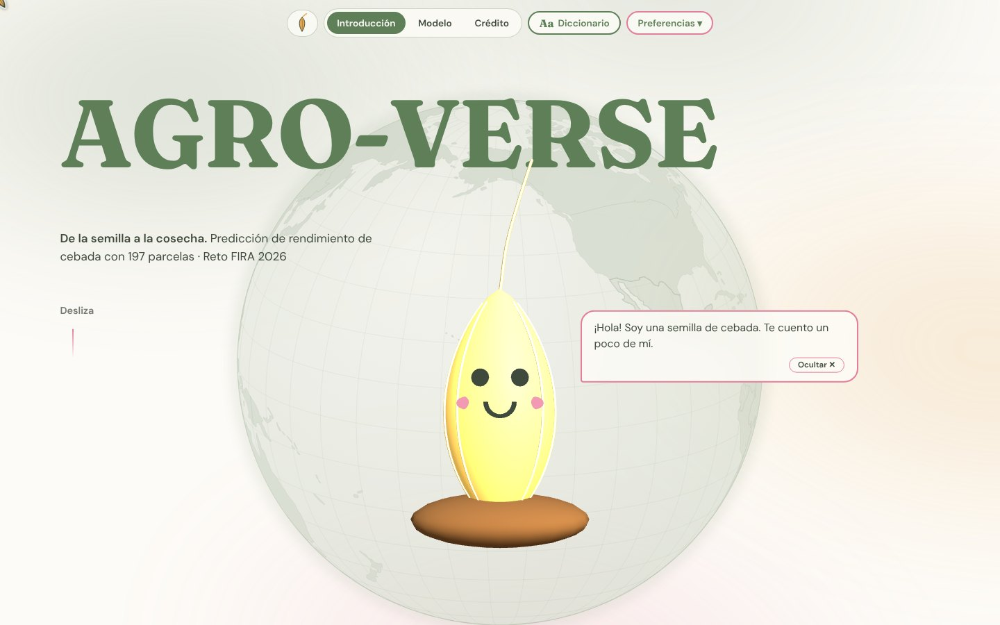
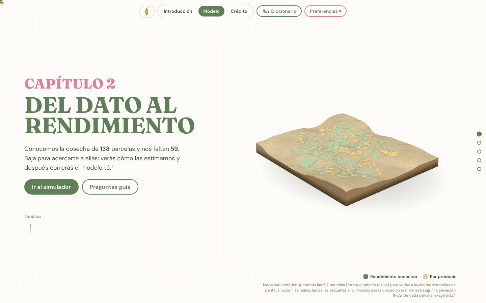
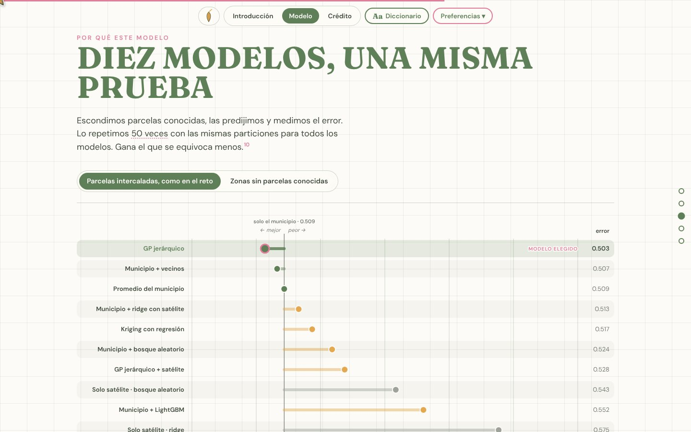
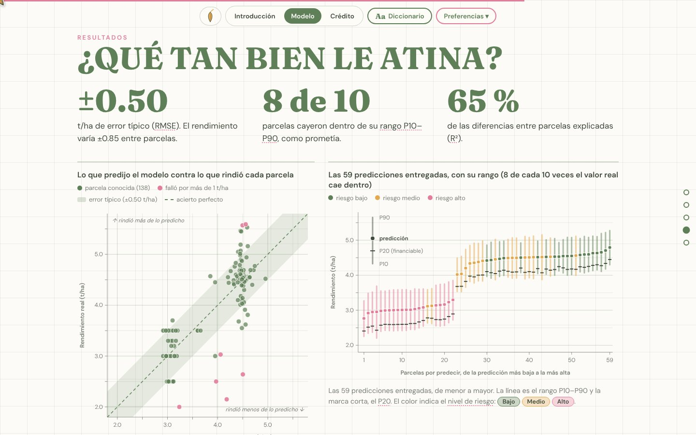
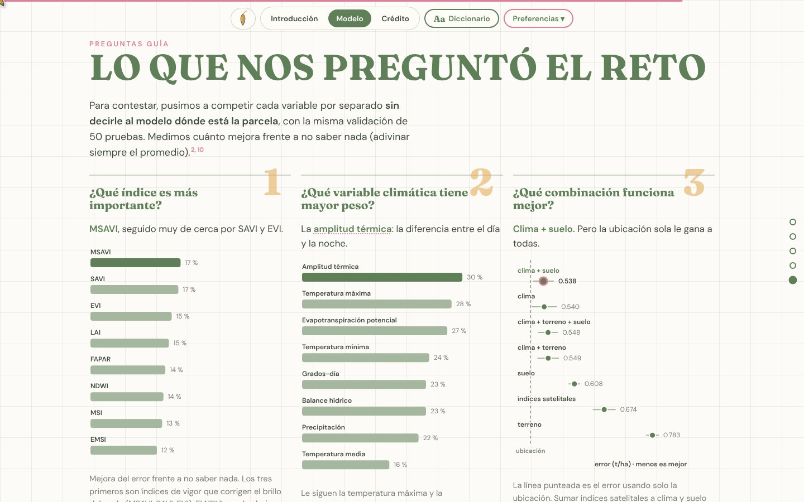
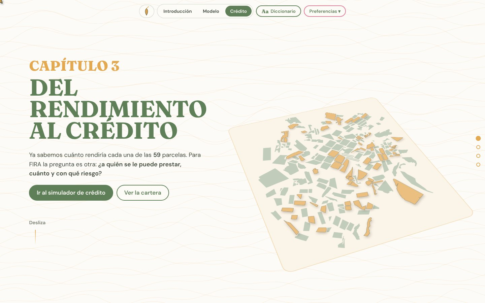
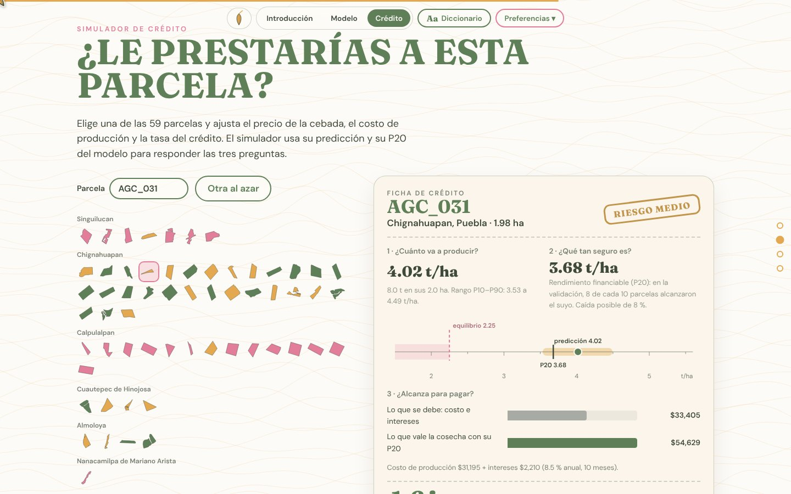
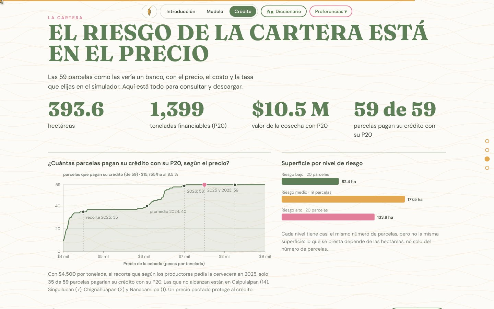

<p align="center"><a href="README.md">Español</a> | <b>English</b></p>

# Cebada-verse · FIRA 2026 (AgroCebada Challenge)

A three-chapter web experience that tells the story of barley and predicts the yield of the
challenge's 197 plots in Puebla, Tlaxcala and Hidalgo, Mexico (138 with known yield and 59 to predict).

It is plain HTML, CSS and JavaScript with no build step. Everything is computed in the browser: **no backend is required**.
Three.js r128 (used for the mascot) is loaded from cdnjs and the fonts from Google Fonts. Without an internet connection
the pages still work, but without the mascot and with a fallback typeface.

A project by the Equipo Representativo STEM · UDLAP.

<p align="center">
  <a href="https://agro-cebada-modular.vercel.app">
    
  </a>
</p>

> The website content is in Spanish.

## The challenge

FIRA provided 197 barley plots from the 2025 season: 138 with their actual yield (t/ha) and 59 without it,
together with their polygons and satellite indices. The task is to **predict the yield of the 59 plots** and
explain how the prediction was obtained. This website presents that process for a general audience and shows
how the prediction could be used to grant agricultural credit.

**Live site:** https://agro-cebada-modular.vercel.app

> **About the name:** the project was first called *Agro-verse* and its mascot *Barley Bot*. The final
> name is **Cebada-verse**. Some files, texts and internal code names still use the earlier names; they were
> kept to avoid breaking styles or scripts. "Agro-verse" and "Barley Bot" both refer to Cebada-verse.

## Running locally

From the project root:

```
python -m http.server 5500
```

and open `http://localhost:5500/`. Do not open the files by double-clicking them (`file://`): the pages use
`<base href>` and relative paths that require a server.

**Requirements:** Python 3 (only to serve the folder) and an up-to-date browser with WebGL (Chrome, Edge,
Firefox or Safari). If WebGL is not available, chapter 2 shows a flat map instead of the 3D model.

## Pages

| Chapter | Page | Content |
| --- | --- | --- |
| 1 · Barley and its territory | `vistas/01-introduccion/index.html` (`index.html`) | The origin of barley, with a globe that travels from the Fertile Crescent to Mexico; what barley is (two-row and six-row); production in Mexico; where the challenge plots are located; how barley grows, from sowing to harvest; and 2025, an atypical year (early and late sowing). |
| 2 · The model | `vistas/07-modelo/index.html` (`modelo.html`) | The model's two signals (municipality and neighboring plots) on a 3D model, a simulator that predicts plot by plot, the comparison of 10 models, the results and the guiding questions. |
| 3 · From yield to credit | `vistas/08-credito/index.html` (`credito.html`) | How a bank would read the predictions: P20, break-even point, credit coverage and risk; a simulator with price, cost and interest rate; and the portfolio of the 59 plots, downloadable as CSV. |
| References | `vistas/06-interpretacion/referencias.html` (`referencias.html`) | The site's single bibliography: numbered sources grouped by topic. Chapters cite them with small numbers that open the source. |

The `.html` files in the root only redirect to the page in their folder. To change a page,
edit the one in `vistas/`.

**Top bar (on every page):** Introduction, Model, Credit, **Dictionary** (glossary of terms;
highlighted words in the text can be tapped) and **Preferences**: References, theme
(automatic / light / dark), color-blindness modes (protanopia, deuteranopia, tritanopia) and "Reduce motion".

## Screenshots

<table>
  <tr>
    <td align="center" width="50%"><br /><b>Chapter 2: 3D model of the plots</b></td>
    <td align="center" width="50%"><br /><b>Chapter 2: comparison of ten models</b></td>
  </tr>
  <tr>
    <td align="center" width="50%"><br /><b>Chapter 2: validation results</b></td>
    <td align="center" width="50%"><br /><b>Chapter 2: the challenge's guiding questions</b></td>
  </tr>
  <tr>
    <td align="center" width="50%"><br /><b>Chapter 3: from yield to credit</b></td>
    <td align="center" width="50%"><br /><b>Chapter 3: per-plot credit simulator</b></td>
  </tr>
  <tr>
    <td align="center" width="50%"><br /><b>Chapter 3: portfolio risk</b></td>
  </tr>
</table>

## The model

The final model is a **hierarchical Gaussian process (GP)** (NB07):

```
yield = mean of the 138 known plots + municipality effect + neighboring-plot adjustment + noise
```

- It is computed in the browser by `vistas/07-modelo/motor-hgp.js` and reproduces the 59 submitted
  predictions (differences ≤ 0.0002 t/ha).
- Validation (10 repetitions × 5 folds): **RMSE 0.50 t/ha, R² 0.65**; yield varies by
  ±0.85 t/ha across plots. The P10–P90 range contained the actual value in 8 out of 10 plots.
- In areas without known neighboring plots (spatial validation), the error rises to ±0.66 t/ha.
- All figures come from `vistas/07-modelo/datos-modelo.js`, generated from the official
  NB07 outputs. It is not edited by hand.

Full details in `vistas/07-modelo/LEEME.md`.

## Data

- **From the challenge:** 197 polygons, areas, training yields and 2025 satellite indices
  (NDVI, EVI and LAI from Planet; FAPAR and DSWI from Sentinel-2).
- **Climate:** CHIRPS rainfall and CHIRTS-ERA5 temperature per plot; INEGI elevation.
- **Phenology:** start, peak and end of greenness dates per plot (NB03).
- **Maps:** Natural Earth outlines (simplified).
- **Approximations:** crop stages (sowing, flowering, harvest) are distributed between the start, peak
  and end of greenness, because the challenge does not include sowing or harvest dates. In chapter 2 the
  plots are arranged in a compact model: their shapes are real, but the on-screen distances are not
  (the model always uses the actual coordinates).

Context figures (production, prices, costs, rates) and their sources are listed in `referencias.html`.

## Structure

```
index.html  modelo.html  credito.html  referencias.html    redirects to vistas/
vistas/
  01-introduccion/   chapter 1: globe (d3-geo), index, atypical 2025
  03-crecimiento/    painted field that grows (used by chapter 1)
  02-territorio/     section "Where does barley grow best?" (currently outside chapter 1)
  06-interpretacion/ references
  07-modelo/         chapter 2: model engine, 3D scene, simulator, charts
  08-credito/        chapter 3: credit, simulator and portfolio
  compartido/        styles, utilities, mascot, dictionary, data (data.js)
backend/             FastAPI API from the previous version (not used by the current pages)
```

Each folder in `vistas/` has a `LEEME.md` describing its files, design decisions and how to regenerate its data.

## Regenerating the data

- Chapters 2 and 3 (model): see `vistas/07-modelo/LEEME.md` (`exportar_datos_modelo.py` and `verificar_motor.js`).
- Chapter 1 (globe and 2025): `vistas/01-introduccion/herramientas/` (`exportar_mapa_inicio.py`, `exportar_temporada.py`).
- Requires `numpy` and `pandas`.

## Teamwork

- One branch per change (`git switch -c change-name`) and a pull request to `main`. No direct pushes
  to `main`.
- Each member works in their own folder in `vistas/`. The files in `vistas/compartido/` are used by all
  pages: notify the team before changing them.
- Do not commit `.venv`, `__pycache__`, `.env` or backups.

## Accessibility

- Light, dark and automatic themes; three color-blindness modes.
- "Reduce motion" stops rotations and animations (the system preference is also respected).
- "Skip to content" link and visible focus.
- Preferences are saved in the browser.

## Related repositories

The project is split into two repositories. Both are linked at the end of chapter 2 of the website
(section "¿Quieres ver cómo lo hicimos?").

- **Website (this repository):** [github.com/Hyatxs/AgroCebada-Modular](https://github.com/Hyatxs/AgroCebada-Modular)
- **Predictive model:** [github.com/Valoo-1201/AgroCebada-Modelo](https://github.com/Valoo-1201/AgroCebada-Modelo).
  It contains the notebooks that produce the site's figures (NB03 phenology, NB04 climate, NB07 final model).

## Credits and licenses

- **Challenge data:** provided by FIRA for the AgroCebada 2026 Challenge; used only for this project.
- **Satellite imagery:** Planet and Sentinel-2 (Copernicus, ESA).
- **Climate:** CHIRPS and CHIRTS-ERA5. **Elevation:** INEGI.
- **Outlines:** Natural Earth (public domain).
- **Libraries:** Three.js r128 (MIT license) and d3-geo / d3-array (ISC license, in
  `vistas/01-introduccion/lib/LICENCIA-d3.txt`).

## Team

Equipo Representativo STEM · UDLAP · Lourdes María García Garfias | María Valentina García Hernández | Dana Paola Sánchez Alonso | Dulce Grecia Pérez Capilla | Lizeth Bonilla Díaz
